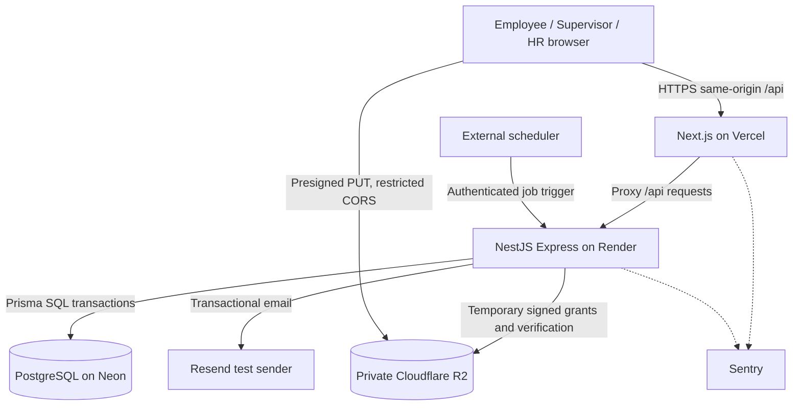

# MyFi ESS — Technical Architecture v1.1 (approved baseline)

**Status:** OWNER-APPROVED v1.1 — conceptual architecture baseline. Integration compatibility and version pinning remain unverified.  
**Date:** 2026-10-31  
**Source of truth:** approved `docs/superpowers/specs/2026-10-31-myfi-ess-design.md`, frozen technology catalog `docs/02-architecture/TECH_STACK.md`, and accepted ADRs. This document details how to implement those decisions without changing requirements.

## 1. Drivers and architecture style

- **Drivers:** 1–50 demo employees, solo agent-assisted development, privacy and auditable leave credit integrity, portable cloud-to-company-server deployment.
- **Chosen architecture:** pnpm-workspace monorepo; separate Next.js frontend and NestJS Express REST API; **feature-modular monolith** in NestJS; one PostgreSQL logical database; private object storage. NestJS uses the approved **Express** adapter; **Multer** is permitted for exceptional backend-managed multipart endpoints, but the standard leave-document flow is direct-to-R2.
- **Excluded:** microservices, a dynamic policy scripting engine, Redis/BullMQ, direct browser access to database, Next.js business-rule duplication, permanent files on Render, and real staff data in demos.

## 2. System context



All third-party services are **demo infrastructure**, not production compliance approval. Moving in-house should primarily change adapters/configuration and deployment, not business entities or approval rules. The company must still complete security, operations, and HR-policy reviews before onboarding real staff.

## 3. Repo structure and ownership

```text
myfi-ess/
  AGENTS.md                         shared agent rules
  CLAUDE.md                         imports shared rules
  apps/
    web/                            Next.js; UI and same-origin proxy only
    api/                            NestJS REST; authoritative business logic
  packages/                         only reusable packages when justified
  docs/
    01-business/                    BRD when drafted
    02-architecture/                TECH_STACK, ARCHITECTURE, DATA_MODEL
    03-api/                         API_SPECS, generated OpenAPI
    04-security/                    SECURITY
    05-quality/                     TEST_PLAN
    06-operations/                  DEPLOYMENT
    adr/                            accepted technology decisions
    superpowers/specs/              approved product design
    superpowers/plans/              owner-approved vertical slice plans
```

Do not create speculative shared packages. Generated API types remain derived from NestJS OpenAPI, not independently hand-authored contract copies.

## 4. Backend module boundaries

| NestJS module | Owns | Does NOT own |
| --- | --- | --- |
| `identity` | Better Auth configuration, invitation/activation integration, MFA/session recovery, user linkage | Leave policy or business approvals |
| `employees` | Employee profiles, departments, statuses, reporting/backup approver assignments, Excel import | Authentication secrets |
| `authorization` | CASL ability construction and per-object authorization checks | Login credentials |
| `leave-policy` | Leave type catalog, immutable published policy versions, eligibility/accrual/document rules, work calendar | Retroactive mutation of approved ledger |
| `leave-request` | Request lifecycle, revisions, submission, overlap warnings, approval routing, correction/cancellation transitions | Direct balance editing |
| `leave-ledger` | Atomic reservations, grants, deductions, releases, reversals, idempotency | User-visible approval decisions |
| `documents` | Signed upload initiation/finalization, private object lifecycle, authorization, quarantine, download | Third-party trusted uploads without checks |
| `notifications` | Persistent in-app items, transactional outbox, Resend/React Email, recipient privacy | Leave eligibility decisions |
| `jobs` | Scheduled job authorization, claims/retries, accruals, expiration processing, outbox dispatch | Untracked time-based mutations |
| `audit` | Append-only security and business activity events | Storing credentials or raw medical reasons |

Module boundaries are logical; keep one deployable NestJS app. Cross-module writes in the same database transaction require clear service contracts, not REST calls between modules.

## 5. Critical request flows

### 5.1 Authentication and MFA

1. HR imports/creates fictional employee, issues expiring single-use invite.
2. Employee sets password and enrolls TOTP. Before a verified factor, all ESS domain endpoints deny access.
3. Browser uses same-origin `/api/auth/*` through a Vercel/Next.js **external rewrite** to Better Auth hosted in NestJS on Render; ordinary `/api/*` routes use the same rewrite boundary. The frontend must not host a second Better Auth server or duplicate business logic.
4. Backend verifies active session, employee status, verified TOTP enrollment/completed challenge, and CASL **plus domain invariants** for every protected endpoint. Cookie presence in Next.js is only a UI hint, not authorization. Direct Render-origin requests must not bypass these checks.
5. Revoke sessions on deactivation and administrative MFA recovery. Trusted-device TOTP bypass disabled; recovery tokens one-time; HR resets require independent controls.

**Integration gate:** The documented NestJS Better Auth integration requires `bodyParser: false`; validate scoped body parsing so Better Auth receives its expected request body while non-auth REST DTOs and validation still work. Verify signup is disabled without breaking HR-issued activation, verify the TOTP enrollment-only route gate, and reject every direct REST path without a completed factor. Proxy tests must cover cookie path/domain, `Set-Cookie`, `Origin`/CSRF, trusted-origin configuration, session revocation, and production browser behavior.

### 5.2 Leave request and credit ledger

1. Frontend asks API for eligible types, policy version, working days and `earned`, `reserved`, `spendable` displays.
2. API validates employment status (including paid-credit locks during probation), pinned policy, leave date-only values, department calendar, document readiness, approver independence, and existing same-employee submissions. Supervisor overlap warnings include **approved and pending** department requests but do not block valid submissions. Enforce all decisions server-side even if UI hides a control.
3. In **one PostgreSQL transaction**, lock the relevant employee/leave-type balance or use an equivalently proven serializable concurrency protocol; validate spendable balance; create the request with a pinned immutable policy version; write a unique reservation ledger event, append a status/audit event and enqueue the notification intent. Conflicting or repeated operations must fail safely, not over-reserve.
4. Supervisor review routes to HR if approved, or rejects/releases reservation if rejected.
5. HR may return (keep reservation, set correction deadline), reject (release), or finalize (convert reservation to debit exactly once). On resubmission, changes to leave dates/duration/type recompute the reservation atomically and require supervisor reapproval; minor changes return to HR. Any capacity shortfall returns a domain error without partial writes.
6. Correction timeout job expires each overdue request once and releases its reservation; an HR extension before expiry reschedules the deadline. Approved-leave cancellation is a distinct workflow and, only when HR confirms an eligible unconsumed absence, produces a compensating ledger event (no destructive history rewrite).
7. Team calendar and notices expose only name and approved absence dates, not leave type/reason/attachments.

**Invariants:** no self-approval (including users with multiple roles); independent HR verification; no negative spendable paid balance from concurrent requests; no duplicate ledger transitions; LWOP never touches paid credits; no deletion/rewrite of prior ledger events; published policy versions immutable. Idempotency must use database-enforced uniqueness, not just application checks. Use exact decimal/integer units rather than JavaScript floating-point for balances.

### 5.3 File upload

1. Browser asks authenticated NestJS API to create upload grant for an authorized leave request.
2. Backend creates a DB-recorded, privately scoped quarantine key and short-lived presigned R2 PUT; validates upload intent, declared size/type and request ownership; configures restricted bucket CORS. The URL authorizes **a specific PUT until expiry**, not a one-time PUT.
3. Browser uploads bytes **directly to R2**, not through Vercel. A leaked signed URL can be used until expiry; do not treat it as one-time without server-side enforcement.
4. Browser requests finalization. NestJS validates object existence and actual bytes (not merely HEAD metadata), size, file signature and anti-malware status. Avoid an upload-to-verification race: bind finalization to an observed immutable object/version or move accepted bytes to a distinct protected final key before `READY`. Quarantine is not directly downloadable.
5. Download/view requires fresh API authorization. Keep team and email notifications free of private attachments.

**Production blocker:** choose and verify malware scanning/quarantine, retention/deletion policy, and access audit requirements before real documents are accepted. The online demo accepts fictional sample files only. Never claim content validation or scanning succeeded based solely on extension/MIME/HEAD fields.

### 5.4 Notifications and scheduling

- Request transitions commit notification **outbox records within the same SQL transaction**.
- NestJS dispatcher claims due jobs using PostgreSQL concurrency locks (for example `FOR UPDATE SKIP LOCKED` behind a tested Prisma/raw SQL boundary), leases and idempotency keys; records attempt, success/failure, and backoff. Jobs are **at-least-once**, so side effects must be safe to retry; an outbound email may be retried unless provider deduplication is verified. Do not rely on in-memory timers on Render Free.
- A protected externally triggered endpoint wakes the application and processes due jobs in **bounded batches**; verify cold-start, request timeout, concurrent triggers and crash recovery. Secure with an independently rotated scheduler secret, strict route scope, request limits and audit log. Do not place secrets in browsable query strings or public repository files.
- In-app items stored in PostgreSQL; TanStack Query polls about once a minute while active. Emails use Resend + React Email; the test sender does **not** send to arbitrary employee addresses.

## 6. Data handling and security

- PostgreSQL tables proposed (not finalized): employee, department, employee status and approver assignments, leave type, published leave policy version, leave request/revision/cancellation, approval action, credit ledger event, document upload/grant metadata, notification, outbox/job, audit record. Better Auth manages its own user/session/MFA plugin schema; link through explicit keys without directly editing plugin-owned secrets or tables.
- Use UTC timestamps for events, **date-only values** for employee leave dates, and `Asia/Manila` for organizational calendar/filing rules. Avoid accidental UTC date shifts when serializing Prisma date-only fields. DATA_MODEL must specify exact credit units, rounding, workday and holiday handling; never use JavaScript floating-point for ledger arithmetic.
- CASL controls role/attribute permissions. Explicit domain checks also enforce no self-approval and independent HR finalization even when users have multiple roles.
- Protected object keys, no R2 credentials to browser, encryption of secrets, Argon2id hash configuration, TOTP backup-code verification, secure cookies, Helmet, strict origins, rate limits, and auditable admin actions.
- Pino structured logs and Sentry error events must scrub employee personal data, passwords, cookies, TOTP, medical files/reasons. Session replay disabled.
- Employee invite-only signups: deny public signup at both authentication handler and account lifecycle, ensure invitation redemption is single-use and time-limited, and do not let public registration be re-enabled via plugin routes. HR sends test emails only to authorized test recipients during demo.

## 7. Deployment and operational implications

| Environment | Web/API/DB/files | Operational note |
| --- | --- | --- |
| Local/test | Next/Nest + PostgreSQL Docker, fake S3-compatible or isolated R2 demo bucket | Testcontainers for integration tests |
| Online demonstration | Vercel/Render/Neon/R2 + Resend test sender | Fictional data; Render sleeps, Vercel Hobby terms; external trigger needed |
| Company future | Containerized services and PostgreSQL/S3-compatible storage | Security, backups, domain, SMTP, server sizing require IT authorization |

Release gate for **real employee data**: documented backup/restore, migration/rollback tests, privacy and retention policy, HR/legal signoff on leave rules and statutory coverage, MFA reset dual-control, malware scanning, incident response, vulnerability remediation, production hosting contract and availability requirements. **These are not solved by a successful fictional-data demo.**

## 8. Architecture review: acceptance scenarios and failure modes

These scenarios must be represented in TEST_PLAN and the owning implementation plans before an agent may mark the relevant feature complete:

1. **MFA bypass:** an invited user who has a password but has not verified TOTP cannot access REST endpoints even by calling Render directly; a disabled employee's prior session is revoked; recovery codes cannot be reused.
2. **Simultaneous filing:** two concurrent 3-day reservations against a 5-day balance result in no more than 5 total reserved; duplicate submission retries do not double-reserve.
3. **Correction race:** an HR deadline extension racing with expiration results in exactly one valid state and no double release; changed leave dates/type recheck capacity and supervisor approval.
4. **Policy history:** publishing a changed policy never recalculates previously approved balances or retroactively changes filed requests without an explicit auditable operation.
5. **Upload race:** a signed URL reused just before expiry cannot replace a READY document with unverified bytes; direct access without document authorization remains denied.
6. **Notification retries:** repeated scheduler invocations cannot duplicate paid-credit accrual/debit or status changes; email send is monitored as at-least-once and may require deduplication/recipient-side protections.
7. **Privacy:** team absence events show names/dates only; no sick leave type, medical reason or attachment is revealed via web, email, logs or Sentry.
8. **Host constraints:** Render cold starts or Vercel proxy failures are visible as transient errors and do not corrupt approval/reservation state; no full employee rollout uses demo-tier services.

### Approved review disposition and remaining technical verification

- **Retained as approved:** framework/library choices, monorepo, modular monolith, role separation, no self-approval, leave ledger and correction semantics, first-party API proxy, direct R2 uploads, queued notifications, PostgreSQL-backed scheduled work, and demo-only hosting.
- **Clarified in this review (not new product scope):** endpoint MFA enforcement, transactional concurrency/idempotency, retry semantics, signed URL reusability and immutable-file finalization, date-only handling, and production rollout gates.
- **Still pending technical verification:** Better Auth/NestJS body parser, invitation and MFA guards, Prisma adapter, cookie rewrite across hosting origins, R2 signature/finalization behavior, job schedule reliability, package-version compatibility and CI runner setup. No feature code has been authorized by this review.
- **Still pending company signoff for real users:** leave entitlements, probationary rules, Saturday schedules, statutory entitlements, privacy/medical-record handling and production infrastructure.

## 9. Related design documents and remaining implementation verification

- `docs/01-business/BRD.md`: approved business requirements baseline; company-specific values still require confirmation.
- `docs/02-architecture/DATA_MODEL.md`: approved logical data model; exact Prisma schema, field names and later approved workflow amendments need reconciliation before migrations.
- `docs/03-api/API_SPECS.md`: proposed technical contract (not owner-approved); route naming, errors, pagination, idempotency and OpenAPI generation require a technical review.
- `docs/04-security/SECURITY.md`: approved security design; session/recovery implementation settings and production privacy signoff remain open.
- `docs/05-testing/TEST_PLAN.md`: approved acceptance baseline; no tests have been run.
- `docs/06-deployment/DEPLOYMENT_GUIDE.md`: approved deployment approach; no environment has been provisioned and no deployment is authorized.
- `docs/superpowers/plans/`: separately authorized vertical-slice implementation plans; **no app code before plan approval**.

## 10. Official references (reviewed 2026-10-31)

- Better Auth NestJS integration: https://better-auth.com/docs/integrations/nestjs
- Better Auth reverse-proxy cookie approach: https://better-auth.com/docs/concepts/cookies
- Better Auth 2FA: https://better-auth.com/docs/plugins/2fa
- Prisma adapter: https://better-auth.com/docs/adapters/prisma
- Cloudflare R2 signed URLs: https://developers.cloudflare.com/r2/api/s3/presigned-urls/
- Vercel external-origin rewrites: https://vercel.com/docs/routing/rewrites
- Render free hosting: https://render.com/docs/free
- Vercel Hobby terms: https://vercel.com/legal/terms
