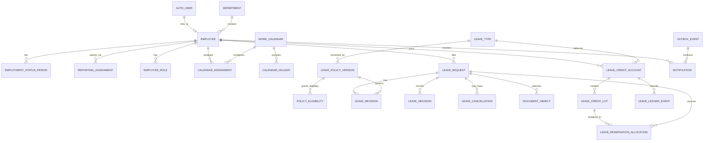

# MyFi ESS — PostgreSQL Data Model

**Version:** 0.1 — owner-approved logical data model  
**Date:** 2026-10-31  
**Status:** OWNER-APPROVED — model principles, fixed-precision credit ledger and credit-lot approach. Approved business amendments after v0.1 are reconciled as a **planning candidate** in `DATA_MODEL_TECHNICAL_RECONCILIATION.md`; no Prisma schema has been generated or approved for execution.  
**Scope:** Phase 1 fictional-data Leave Management MVP; model supports expansion without implementing future ESS modules  
**Sources:** approved `docs/superpowers/specs/2026-10-31-myfi-ess-design.md`, `docs/01-business/BRD.md` v0.1, `docs/02-architecture/ARCHITECTURE.md` v1.1, `docs/04-security/SECURITY.md` v0.1, `docs/02-architecture/TECH_STACK.md` v1.0.

> **Boundary:** This is a logical/relational design, not a completed or migrated Prisma schema. No migrations, database, data imports or production infrastructure have been created. Table/column names below are proposed implementation contracts; compatibility with the installed Better Auth + Prisma versions must be confirmed before schema generation. Fictional test data only until organizational approval.

## 1. Modeling principles

1. **One PostgreSQL database**, used through Prisma in the NestJS modular monolith; no direct database connection from Next.js.
2. **Better Auth owns its own auth tables**. Do not fork or edit those tables by hand. Employee and privilege records belong to the ESS domain and link to the authoritative auth user ID after the integration spike.
3. **Immutable business history:** published leave policies, decision events, leave-credit journal entries and audit events are never overwritten to change the past. Corrections append new events or revisions. Ordinary employee/master-record fields are updateable with audit history.
4. **Reliable financial-style accounting:** fixed-precision leave credit units, atomic balance updates, explicit reservations, unique business-effect keys and concurrency tests. No floating-point leave arithmetic.
5. **Separate private and public representations:** team calendar queries return only employee name and approved absence dates. Leave reason, type, private attachments and employee personal email never ride along in team data.
6. **Date-only leave periods; timestamped actions:** leave dates/holiday dates are local calendar dates; events have UTC timestamps and organizational date evaluation uses `Asia/Manila`.
7. **Explicit policy snapshots:** every submitted revision points to the policy version and work-calendar calculation used to determine that revision's eligibility and duration. A new policy does not silently alter old requests.
8. **No invented company policy:** 10 VL/10 SL, probationary accumulation/locking, and Monday–Friday are demo fixtures, not employer policies.

## 2. Key and type conventions

| Concern | Proposed convention | Verification rule |
| --- | --- | --- |
| Primary keys | PostgreSQL UUID (`id`) generated server-side | Use consistent UUID generation throughout Prisma; avoid exposed sequential IDs |
| Timestamps | `timestamptz` / `DateTime @db.Timestamptz(6)` in UTC | Server timestamps; never client-authoritative |
| Calendar dates | PostgreSQL `date` (`DateTime @db.Date`) | API accepts/emits `YYYY-MM-DD`, with explicit date-only mapping |
| Leave units | Signed `BIGINT` representing **1/10,000 of a working day** | `10.0000 days = 100000 units`; no JS `number` math on money-like values |
| Duration display | Convert exact units to decimal strings in API | Half-day filing is not enabled; internal fractional accrual remains possible |
| Credits per year | Annual allowance stored in integer units | Demo 10 days = 100000 units; `monthly = quotient + remainder` reconciliation |
| IDs/business codes | `employee_code`, `leave_type.code` are case-normalized unique strings | Never silently reuse retired business identifiers |
| Free text | Privileged request/reason data, maximum lengths defined in API specification | Do not copy into logs, events, public calendar or team notices |
| States | Bounded enums mapped to documented transitions | Persisted state alone does not authorize a transition |
| Idempotency | Unique database-enforced `effect_key` and request-operation keys | Retries with same key return prior effect; conflicting payload rejected |
| Soft deletion | Deactivate reference data, preserve linked history | Retention/deletion policies remain subject to company approval |

**Accrual precision proposal:** Calculate grants in 1/10,000-day units. For a 10-day annual allowance accrued in 12 equal months, allocate 8,333 units to months 1–11 and 8,337 units to the last month, totaling exactly 100,000 units. For partial employment periods, policy-approved proration is needed; do not infer automatic grant rules from this example. Values and rounding are a **technical proposal**, not an approved HR policy.

## 3. Logical entity map

`AUTH_USER` stands for the Better Auth-owned user model, not an ESS-owned replacement. The diagram omits secondary links, jobs, audit and Excel imports for readability. See tables below for authoritative relationships.

## 4. Core entities and ownership

### 4.1 Identity, employee and organization

| Proposed table | Key fields / constraints | Owner and purpose |
| --- | --- | --- |
| `employee` | `id`; unique `employee_code`; optional unique `auth_user_id`; `invited_email_normalized`; `display_name`; `hired_on`; `department_id`; `active`; `created_at`, `updated_at` | Employees module. An employee may exist before account activation. Auth user link is unique; deactivate rather than delete. |
| `department` | `id`; unique `code`; `name`; `active`; optional `parent_id` | Employees module. Department membership scopes calendar/overlap visibility. |
| `employment_status_period` | `id`; `employee_id`; `status` (e.g. `PROBATIONARY`, `REGULAR`); `effective_from`; nullable `effective_until`; `recorded_by` | Dated status history for eligibility and future grants. Prevent overlapping periods for an employee. |
| `reporting_assignment` | `id`; `employee_id`; `primary_approver_employee_id`; nullable `backup_approver_employee_id`; `effective_from`/`effective_until` | Time-bounded routing. Prevent self-assignment and routing cycles via domain validation; snapshot selected approver on submission. |
| `employee_role` | `id`; `employee_id`; `role` (`EMPLOYEE`, `SUPERVISOR`, `HR_VERIFIER`, `HR_ADMIN`); active interval; `granted_by` | CASL ability inputs; multi-role allowed, explicit no-self-approval overrides role union. |
| `employee_invitation` | `id`; `employee_id`; unique `token_hash`; `expires_at`; `consumed_at`; `revoked_at`; `issued_by` | ESS-controlled invitation lifecycle; link to Better Auth activation only after safe integration test. |
| `mfa_recovery_case` | `id`; `employee_id`; `initiated_by`; `authorized_by`; `identity_verification_ref`; `status`; timestamps | Tracks HR-assisted recovery approvals, *not* TOTP seeds or recovery codes. Separate authorization required. |
| `employee_import_batch` | `id`; `uploaded_by`; `state`; counts; `created_at`; `committed_at` | Excel preview/commit, with duplicate/error counts and audit. Do not persist raw spreadsheets indefinitely. |
| `employee_import_row_issue` | `id`; `batch_id`; `row_number`; `field`; `safe_error_code`; optional sanitized detail | Shows import errors without retaining sensitive raw row payloads. |

**Auth ownership:** Better Auth migrations own the user/session/account/TOTP plugin tables. `employee.auth_user_id` is nullable until activation; key type and actual foreign-key strategy must follow the tested adapter's generated schema. Never create duplicate password/session/TOTP tables in our domain. Do not store secrets in `employee`, invitation or audit records.

**History:** Preserve department and reporting changes through dated assignments or explicit audit records. Employee `department_id` denotes the current department; the leave revision records the department under which it was submitted. Employee IDs, not emails, provide stable identity across email changes.

### 4.2 Work calendars and holiday rules

| Proposed table | Key fields / constraints | Owner and purpose |
| --- | --- | --- |
| `work_calendar` | `id`; `code`; `timezone` (demo `Asia/Manila`); `week_mask` (demo Mon–Fri); `version`; `effective_from` | Leave-policy module. Structured rules only, no arbitrary scripts. |
| `calendar_holiday` | `id`; `work_calendar_id`; `holiday_date`; `is_non_working`; `label`; unique `(work_calendar_id, holiday_date)` | Date-specific exclusions. Demo holiday list is a fixture, not a legally validated schedule. |
| `calendar_assignment` | `id`; `employee_id`; `work_calendar_id`; effective interval; no overlaps per employee | Determines working-day count at filing. Phase 1 uses Monday–Friday; extra schedules are not automatically enabled. |

`leave_revision.calculated_units` and `work_calendar_id`/`calendar_version` preserve what the system calculated at submission. Calendar edits cannot silently change previous leave requests. Actual six-day schedules require a later approved enhancement.

### 4.3 Leave configuration and published policies

| Proposed table | Key fields / constraints | Owner and purpose |
| --- | --- | --- |
| `leave_type` | `id`; unique normalized `code` (e.g. `VL`, `SL`, `LWOP`); `name`; `is_paid`; `active`; audit timestamps | HR-managed leave catalog. `is_paid` is immutable once credits or published requests exist; changing paid/unpaid semantics requires an explicitly approved migration or distinct leave type. Deactivation prevents new filing, not historical access. |
| `leave_policy_draft` | `id`; `leave_type_id`; structured fields below; `last_edited_by`, `updated_at` | Editable configuration. Publishing inserts an immutable version. |
| `leave_policy_version` | `id`; `leave_type_id`; `version_number`; `effective_from`; `published_at`; `published_by`; copied structured rule fields; unique `(leave_type_id, version_number)` and `(leave_type_id, effective_from)` | Immutable policy snapshot. Future effective policies selected by `effective_from <= evaluation_date` and greatest effective date. |
| `policy_eligibility` | `id`; `policy_version_id`; `employment_status`; `may_file`; `may_accrue`; `may_spend`; unique `(policy_version_id, employment_status)` | Enables probationary earning while restricting usage, and LWOP filing without paid credits. |
| `leave_policy_exception` | `id`; `employee_id`; nullable `request_id`; `policy_version_id`; `exception_kind`; `reason`; `approved_by`; `created_at` | Audited HR-approved exceptions; does not bypass legal requirements or self-approval. |

**Structured policy fields** to copy into a published version: `allocation_method` (`ANNUAL`, `MONTHLY`, `NONE`), `annual_units`, `accrual_anchor`, `proration_method` (only implemented methods permitted), `filing_advance_workdays`, `retroactive_filing_workdays`, `attachment_mode` (`OPTIONAL`, `ALWAYS`, `AFTER_N_WORKING_DAYS`), `attachment_threshold_workdays`, `correction_deadline_workdays`, `carryover_allowed`, `carryover_cap_units`, `expiry_rule`, `cash_conversion_allowed`, and effective dates. Unknown/null semantics and enum options must be fixed in `API_SPECS.md` before code generation, not added opportunistically by agents.

**Publishing contract:** A draft is validated and explicitly published; the published row and its child `policy_eligibility` rows are append-only/immutable. An effective-dated later version supersedes it for new evaluations; no published row is edited merely to close the old version. A filed revision references the version actually applied. On *material* resubmission, record a **new revision**, re-evaluate the policy applicable to that resubmission, and preserve earlier revision/version links. Previously finalized requests remain unchanged.

### 4.4 Leave applications, revisions and decisions

| Proposed table | Key fields / constraints | Owner and purpose |
| --- | --- | --- |
| `leave_request` | `id`; `employee_id`; `current_revision_id`; `status`; `department_at_submission_id`; `assigned_supervisor_id`; nullable `assigned_hr_verifier_id`; `correction_due_at`; `submitted_at`; `version` (optimistic lock); timestamps | Current workflow state; status changes require expected-state predicates and immutable action history. |
| `leave_revision` | `id`; `request_id`; `revision_no`; `created_by`; `leave_type_id`; `policy_version_id`; `work_calendar_id`; `calendar_version`; `start_date`; `end_date`; `calculated_units`; protected `reason`; `created_at`; unique `(request_id, revision_no)` | Historical filing content. Revision 1 submitted initially; each correction creates a new revision. |
| `leave_decision` | `id`; `request_id`; `revision_id`; `stage` (`SUPERVISOR`,`HR`); `decision` (`APPROVE`,`REJECT`,`RETURN`,`FINALIZE`); `actor_employee_id`; `reason`; `acted_at`; unique `operation_key` | Append-only authorization/decision history. Actor must not equal request employee. |
| `leave_cancellation` | `id`; `request_id`; `requested_by`; `reason`; `status` (`PENDING_HR`,`APPROVED`,`REJECTED`); `reviewed_by`; timestamps; unique active request constraint | Separate HR-reviewed cancellation lifecycle; no deletion or silently editing approved leave. |
| `leave_request_event` | `id`; `request_id`; `revision_id`; `event_kind`; `from_status`; `to_status`; `actor_employee_id` nullable for job; `occurred_at`; `metadata` sanitized | Append-only status transition timeline including expiration, resubmission and correction deadline extension. |

**Original v0.1 proposed state machine:** `PENDING_SUPERVISOR`, `PENDING_HR`, `RETURNED_FOR_CORRECTION`, `APPROVED`, `REJECTED`, `EXPIRED`. **Owner-approved amendment adds terminal `WITHDRAWN`; no `DRAFT` feature.** See `DATA_MODEL_TECHNICAL_RECONCILIATION.md`. An approved request with an approved cancellation remains historically `APPROVED`, but has a separate effective cancellation outcome; public calendar excludes approved cancellations. For unapproved requests, the approved action is **self-withdrawal (`WITHDRAWN`)**, not cancellation; `CANCELLED` was an earlier unapproved working label. Closing an approved leave uses the separate HR-reviewed cancellation lifecycle. Avoid inferring that a cancellation request automatically cancels an approved absence.

**Revision rules:** Major edits to dates, computed duration or leave type select a fresh supervisor route (and may change reservation allocation). Minor corrections may return to HR. HR return retains the active reservation until resubmission, rejection or expiry. Deadline extensions must be approved while still returned; expiration workers use expected-state and due-time predicates to win/lose races safely.

### 4.5 Leave credits, lots, reservations, and immutable ledger

**Chosen accounting representation:** use 1/10,000-day integer units, a locked aggregate account per `(employee_id, leave_type_id)`, and credit lots to support carryover and expiry. All state changes write an immutable ledger effect and update projections **in the same transaction**. This is a *proposed physical model* to be approved with this document; it is not yet a migrated database.

| Proposed table | Key fields / constraints | Purpose |
| --- | --- | --- |
| `leave_credit_account` | `id`; unique `(employee_id, leave_type_id)`; `posted_units`; `reserved_units`; `used_units`; `version`; timestamps | Lock row for each paid leave balance change; `spendable = posted - reserved - used` if policy permits spending. LWOP has no paid account. |
| `leave_credit_lot` | `id`; `account_id`; `policy_version_id`; `source_period`/`source_effect_key`; `granted_on`; nullable `expires_on`; `posted_units`; `reserved_units`; `used_units` | Tracks credit source and remaining value so expiry/carryover operate on eligible unreserved units. Each lot has a stable identity. |
| `leave_reservation_allocation` | `id`; `request_id`; `lot_id`; `reserved_units`; unique `(request_id, lot_id)` | Current request-to-lot reservation projection. Mutable only through ledger-backed transactions; append-only events retain its history. |
| `leave_ledger_event` | `id`; `account_id`; nullable `lot_id`; nullable `request_id`; `event_type`; signed `posted_delta_units`, `reserved_delta_units`, `used_delta_units`; unique `effect_key`; nullable `reverses_event_id`; `actor_id` or job reference; `created_at` | Append-only source of truth for grants, reservations, finalization, releases, expiry, carryover, conversion and reversals. |
| `leave_conversion_record` | `id`; `employee_id`; `leave_type_id`; `units`; `approved_by`; `reason`; `status`; nullable `ledger_event_id`; timestamps | Documents **eligibility and recorded conversion only**; no payroll payment or amount calculation in MVP. |

**Derived balance:** `credited/posted = sum(posted_delta_units)`; `reserved = sum(reserved_delta_units)`; `used = sum(used_delta_units)`; `spendable = posted - reserved - used`. Account totals are the transactional projection, and must equal ledger sums. All units must be nonnegative where expected: `posted >= 0`, `reserved >= 0`, `used >= 0`, and `posted >= reserved + used`. Per-lot totals obey equivalent bounds. These checks apply at **transaction commit**; projection updates and ledger events may never commit separately.

**Journal examples (units represent 1/10,000 day):**

| Event | `posted_delta` | `reserved_delta` | `used_delta` | Meaning |
| --- | ---: | ---: | ---: | --- |
| Credit grant of 5 days | `+50000` | `0` | `0` | Increase posted balance |
| Submit 3-day VL | `0` | `+30000` | `0` | Reserve, but do not deduct |
| HR finalizes 3-day VL | `0` | `-30000` | `+30000` | Convert reservation to usage |
| Reject still-pending 3-day VL | `0` | `-30000` | `0` | Release hold |
| HR-approved cancellation of 3 unconsumed days | `0` | `0` | `-30000` | Audited restoration; lot expiry constraints still apply |
| Expire 2 unused days | `-20000` | `0` | `0` | Remove only unreserved, unused credit |

Each action may emit **one row per affected lot**, with a unique `effect_key` suffix per lot, while a request-level operation key prevents replay of the overall transition. Every finalized debit or expiry must identify the source lot(s), and cancellations must compensate the corresponding lot(s) where still valid. If a credit lot has expired or been converted, the system must **not silently resurrect it**; HR-approved restoration to a new valid lot is a separately authorized and audited operation.

**Lot allocation:** Reserve available unexpired lots in deterministic expiry-first order (tie-break by lot ID). Before any debit, reserve/expiry/carryover, lock `leave_credit_account`, select eligible lots under the same transaction, validate the total, update the lot projections and write journal events. Supervisor approval does not affect paid credit. Changing dates/type releases and re-reserves in one transaction (including across two leave accounts in consistent lock order). A returned request keeps its allocations. Cancellation of approved leave requires separate HR review and compensating effects.

**Accrual and year-end:** Every scheduled accrual uses a unique effect key derived from `(employee, leave type, earning period, policy version)`; repeat job executions are no-ops after the first grant. Carryover may post paired negative/positive lot moves, with no net new benefit, while expiry or conversion reduces posted units only as authorized. Applying a new policy does not recompute past grants. An annually allocated policy receives one period grant; monthly accrual receives distinct period grants; proration rules are explicit configuration, not inferred.

**Probationary employees:** earnings may post to lots while eligibility sets `may_spend=false`, so earned totals appear, but available-to-file is zero. Regularization changes eligibility according to dated policy/status, without fabricating a grant. **LWOP creates no leave-credit account reservation or debit**, but the approved request records unpaid working-day units for a future authorized payroll integration.

### 4.6 Attachments, notifications, jobs and audit

| Proposed table | Key fields / constraints | Purpose |
| --- | --- | --- |
| `document_object` | `id`; `request_id`; `uploaded_by`; `quarantine_key` unique; nullable `final_key` unique; `upload_status` (`GRANTED`,`UPLOADED`,`VERIFYING`,`READY`,`REJECTED`,`PURGED`); `scan_status` (`NOT_SCANNED`,`PENDING`,`CLEAN`,`BLOCKED`); byte length, content type, checksum; grant/finalize timestamps | Tracks direct-to-R2 uploads, verification and immutable promoted content. Never store a signed URL or R2 credentials. |
| `document_access_event` | `id`; `document_id`; `actor_employee_id`; `access_kind`; `occurred_at` | Append-only access audit, with no signed URL/file contents. |
| `notification` | `id`; `recipient_employee_id`; `event_kind`; minimal safe `payload`; `read_at`; unique `dedupe_key`; `created_at` | Persistent user notification; avoid sensitive free text. |
| `outbox_event` | `id`; `aggregate_kind`; `aggregate_id`; `event_kind`; minimal payload; unique `dedupe_key`; `available_at`; `state`; `attempts`; timestamps | Created in the same transaction as the business effect, later claimed for notification delivery. |
| `scheduled_job` | `id`; `job_kind`; unique `effect_key`; `due_at`; `status`; `lease_owner`; `lease_until`; `attempts`; `last_error_code`; timestamps | PostgreSQL-backed scheduled job state for accrual, correction expiry, outbox dispatch and cleanup. |
| `job_attempt` | `id`; `job_id`; `attempt_no`; `started_at`; `finished_at`; `outcome`; sanitized error code | Diagnostic job history without secrets or private payloads. |
| `audit_event` | `id`; nullable `actor_employee_id`; `action`; `resource_kind`; `resource_id`; `occurred_at`; sanitized `metadata`; nullable correlation ID | Append-only privileged/business audit. May reference system actor for jobs; avoid plaintext medical reasons or credentials. |

**Document readiness:** Only `READY` files associated with the exact authorized request may be downloaded. The browser cannot promote quarantine content to ready by itself; NestJS verifies actual bytes, scan state, checksum and immutable promotion. A missing scanner cannot silently produce `CLEAN`; if scanner integration is unavailable for the demo, upload/verification demonstrations must remain quarantined unless a separate, explicitly approved sample-only policy is documented and gated from production. A resent presigned PUT can overwrite the quarantine key until expiry but must never mutate the final key. **Demo files only** until malware scanning, retention and security signoff are completed; `NOT_SCANNED` must remain explicit, never implied `CLEAN`.

**Notification privacy:** Team events are derived from `APPROVED` (and not effectively cancelled) leave requests and expose only name + absence dates. Do not include `leave_type_id`, leave reason, document ID, medical details, personal email or raw request payload in team calendar/outbox/email payloads. HR/private notification payloads likewise should prefer IDs and server-side lookups to copying sensitive text.

**Outbox and job semantics:** Delivery may be at-least-once, so business state must be exactly-once by keys and expected-state transactions. Email providers may not guarantee de-duplication; model `outbox_event` status/attempt IDs and avoid falsely promising exactly-once email. Claim jobs with row locking and a lease; a dead worker must not leave permanent locks.

## 5. Critical relationships and DB-enforced constraints

| Invariant / need | DB enforcement | Service-layer enforcement |
| --- | --- | --- |
| Employee code / leave code uniqueness | Unique normalized code/index | Normalization, friendly conflict errors |
| One auth user per employee | Unique nullable `auth_user_id` | Invitation activation and disabled-account checks |
| Dated assignments do not overlap | PostgreSQL exclusion/range strategy where feasible, or transaction + constraint | Effective dates, approver cycles, fallback validity |
| Immutable policy publication | Insert-only permission/trigger or guarded table writes; version uniqueness | Publish transaction validates complete rule schema |
| Per-request revision ordering | Unique `(request_id, revision_no)` | Only append on valid transitions |
| No duplicate state transition | Unique `operation_key` and expected-state update | No-self-approval, MFA complete, correct stage, independent HR verifier |
| No over-reservation | Account/lot CHECK constraints and row-lock transaction | Spendable recheck using latest balance/policy |
| Credit source integrity | FKs to account, lot and request; unique `effect_key` | Append-only compensations; no ledger rewrites |
| One current reservation per request/lot | Unique `(request_id, lot_id)` | Recalculate allocations atomically on material edits |
| No multiple pending cancellations | Partial unique index on `(request_id)` with `status='PENDING_HR'` | Verify leave is approved and not consumed |
| No duplicate accrual/monthly grant | Unique accrual `effect_key` | Retry job idempotently, no double grant |
| Safe private files | Unique quarantine/final keys; status constraints | Authorization, byte/scan verification, immutable promotion |
| Team privacy | Minimal projection/response; no public table joins to reasons | CASL/RBAC, safe DTOs, contract tests |
| Outbox notification deduplication | Unique `dedupe_key` | Replays skip duplicate intent; provider delivery semantics tracked |

**Migration guidance:** Prisma schema and SQL migrations may need reviewed native SQL for exclusion indexes, partial unique indexes, ledger immutability and other PostgreSQL-only constraints. Agents must not weaken constraints merely because Prisma's declarative schema lacks a construct. Validate generated SQL migrations against an isolated PostgreSQL Testcontainers instance and use backward-compatible changes where possible.

## 6. Transaction and concurrency contracts

All workflows below require a single database transaction for business updates, ledger and outbox effects. No R2 or email calls should run *inside* these transactions. Externally visible side effects follow from committed outbox/state.

| Operation | Atomic updates | Rejection/race behavior |
| --- | --- | --- |
| Submit paid leave | Check eligibility and spendable; add request/revision, reservation allocations, ledger events, state event, outbox | Duplicate request key returns previous result; conflict yields business error; never negative spendable |
| Supervisor decision | Verify current assignee, expected stage and actor != owner; add decision/state/outbox | Duplicate decision ignored safely; stale assignee/state rejected |
| HR finalization | Verify independent HR actor and current revision; convert reserved to used, decision, status, outbox | Duplicate finalization must not debit twice |
| HR return | Hold reservation; set correction deadline; record reason/action and notification | Competing HR decision wins once via expected state |
| Resubmit material edit | Compare revisions; lock old/new accounts; release/reassign lots; append revision, state, outbox | Insufficient new credits aborts entire change and retains old reservation |
| Correction expiry/extension | Compare deadline and state under lock; append expiry or extension, release once, outbox | Exactly one transition on race; idempotent retry |
| HR-approved cancellation | Verify allowed unconsumed period and independent actor; reverse usage within valid credit lots, cancellation status, outbox | No duplicate restoration; expired-lot edge case requires explicit HR remedy |
| Accrual/carryover/conversion | Lock account, grant/transfer/expire, ledger event(s), outbox, job completion | Unique period/effect key prevents duplicate or unintended backdated grants |

**Lock ordering:** When more than one credit account is touched (e.g., change of leave type), lock in ascending account UUID order to reduce deadlocks. Use PostgreSQL account row locks/serializable transactions with bounded retry on serialization/deadlock errors. The success path must be tested under concurrent requests using a real PostgreSQL instance.

## 7. Index and query design

Recommended indexes (in addition to primary and foreign key indexes):

- `employee(department_id, active)` and `employee(employee_code)`; email normalized unique policy after HR verifies identity rules.
- `reporting_assignment(employee_id, effective_from)`; `employment_status_period(employee_id, effective_from)`.
- `leave_policy_version(leave_type_id, effective_from DESC)` for effective policy lookups.
- `leave_request(employee_id, status, submitted_at DESC)` for own history; `(assigned_supervisor_id, status)` and `(assigned_hr_verifier_id, status)` for review queues.
- `leave_revision(request_id, revision_no DESC)`; calendar overlap queries join **current revision only** for date interval. For high volume, evaluate GiST date range index later, not in demo by default.
- `leave_credit_lot(account_id, expires_on, granted_on)` for deterministic allocation.
- `leave_ledger_event(account_id, created_at)` and `(request_id, created_at)` for reconciliation/audit.
- `notification(recipient_employee_id, read_at, created_at DESC)` for unread count and history.
- `scheduled_job(status, due_at)` and `outbox_event(state, available_at)` for bounded worker claims.
- `audit_event(resource_kind, resource_id, occurred_at)` for authorized audit retrieval.

**Retention and scaling:** These indexes are the starting set, not a promise of performance. Evaluate query plans with representative fictional datasets. No premature partitioning, generic event bus or secondary search system for 1–50 employees.

## 8. Privacy, data lifecycle and access

- Employees only read their own full leave records; approvers see only assigned review data; HR access depends on role and independent verification. Enforce at NestJS with Better Auth completed-session state, CASL, record predicates and explicit self-approval prohibitions.
- Expose sanitized **team calendar view** from approved active absence revisions, never from unrestricted leave_request rows. No reasons, leave categories, personal email or attachments in the returned model.
- Keep signed R2 URL secrets, TOTP seeds, password hashes, raw recovery materials and HR identity proof out of application domain payloads, logs, Sentry and audit metadata.
- Employee deactivation prevents login but does not purge approvals/ledger history. Archived metadata or file deletion must follow an approved retention schedule and applicable privacy rights; do not infer arbitrary 30/90-day defaults.
- The MVP contains fictional employee records and sample documents only; production requires HR/legal/DPO/IT review, retention, backup/restore, malware scanning and vendor/hosting evaluation.

## 9. Proposed Prisma modeling and migration sequence

The following is a **planning order** for isolated feature work; it is not authorization to start development. Prisma model names and enums should be selected consistently before generating migrations.

1. **Identity/organization:** verify Better Auth-generated Prisma schema and integration. Add employee/department/status/roles/approver/invitation tables with stable IDs and constraints.
2. **Structured policies/calendar:** leave types, drafts, immutable published versions, eligibility, holiday/work calendars; load controlled fictional demo fixtures.
3. **Ledger foundation:** credit accounts, lots, append-only events, reservation allocations; concurrency tests and reconciliation query before any request workflows.
4. **Requests/decisions:** request/revision/state transitions, supervisor/HR decisions, cancellations and audit/outbox. If schema cyclic FKs arise, use nullable staged links or a deliberate migration order.
5. **Documents and notifications:** upload grants, verification metadata, in-app notifications, outbox jobs and restricted retrieval logs.
6. **Reconciliation/operations:** test repeat job runs, restore and migration behavior, read-only balance reconciliation, authorization negative tests.

**Agent governance:** No product scaffolding, migrations or code are approved simply because these steps appear here. Each implementation slice needs its own approved `docs/superpowers/plans/` plan; new production packages or major schema changes require owner review/ADR.

## 10. Open choices for implementation planning

The owner has approved **behavior**, but not every low-level format or company policy. Resolve without silent assumptions:

- **Approved conceptual choices:** use 1/10,000-day integer units, source credit lots and append-only ledger events. **Still to define technically:** auth-user/employee linkage, request revision semantics under policy changes and physical schema amendments documented in `DATA_MODEL_APPROVED_AMENDMENTS.md`.
- **Before code generation:** settle scanner/verification handling for fictional demo samples (no implicit `CLEAN` status); verify Better Auth plugin schema/version and key types; choose exact Prisma field names and migration order; define return/deadline exception enum values and canonical status/HTTP error mapping with API contract.
- **Before company production:** HR approval of accrual/proration, rounding and unused credit treatment; holiday and Saturday rules; medical-document retention and access; which roles may perform credit adjustments/cash conversion; limits on confidential data; vendor and server security signoff.

## 11. Test acceptance contracts and requirement mapping

| Proof / test | Relevant baseline | Data/model assertion |
| --- | --- | --- |
| Concurrent paid leave filings | BR-026/027, UAT-03, NFR-03 | One locked account; total reservations cannot exceed posted less used; conflicting request rolls back |
| Supervisor then HR finalization | BR-018/024/027, UAT-07/09 | Independent actor, exactly one reservation-to-usage transition; decision history preserved |
| Retroactive VL/SL policy update | BR-008/013, UAT-11 | Old revisions retain policy foreign keys; new version insert-only; old grants not changed |
| Probationary employee | BR-014/029, UAT-02 | Can accrue paid credits, spendable to file zero, LWOP no account ledger |
| Major correction and timeout race | BR-020/021/022, UAT-05/06 | Revised snapshot, atomic lot reallocation; extend-v-expire picks exactly one outcome |
| Approved cancellation | BR-023/028, UAT-10 | Independent HR authorization and one compensating ledger event; history retained |
| Secure file upload | BR-034, NFR-01/02, UAT-12 | Quarantine cannot become READY without verified immutable content; unauthorized retrieval rejected |
| Team visibility | BR-030/031, UAT-08 | Calendar/notifications contain names/dates only; sensitive fields unavailable |
| Repeat scheduler | BR-022/028, UAT-13 | Unique period/effect keys prevent duplicate accrual/debit/expiry, even with concurrent claims |
| Working days and holidays | BR-016, UAT-14 | Friday–Monday yields two days on Mon–Fri demo calendar, excluding non-working holidays |

## 12. Review checklist

- [x] Owner approved the logical entity boundaries, 1/10,000-day units, source-lot approach and policy-version principles; physical schema details remain open.
- [ ] Account + lot + journal accounting is verified with reconciliation and concurrent transaction tests in PostgreSQL when code begins.
- [ ] Better Auth generated schema compatibility is checked before writing employee-to-user foreign keys.
- [ ] Leave-state and cancellation rules match API contract and cannot self-approve or double debit.
- [ ] Access-controlled calendar model contains only allowed fields; no medical details leak.
- [ ] R2 object promotion, status and access audits meet SECURITY.md.
- [ ] Every table has documented ownership and an approved lifecycle/retention approach before real data.
- [ ] DATA_MODEL changes after approval require an ADR if they alter invariants or architecture, plus updated tests/contracts.

## 13. Reference documents

- `docs/01-business/BRD.md` — business objectives, BR/NFR/UAT mapping.
- `docs/02-architecture/ARCHITECTURE.md` — module ownership, workflows, concurrency/security boundaries.
- `docs/02-architecture/TECH_STACK.md` — selected technologies and versions gate.
- `docs/04-security/SECURITY.md` — MFA, privacy, authorization and document controls.
- `docs/superpowers/specs/2026-10-31-myfi-ess-design.md` — owner-approved product behavior.
- `docs/governance/AGENT_GOVERNANCE.md` — agent autonomy and review requirements.
