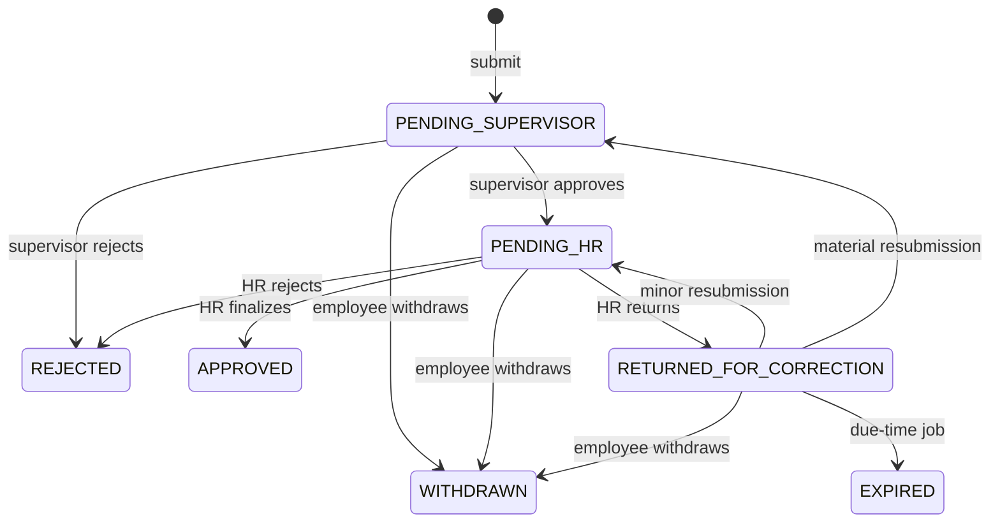

# MyFi ESS — API Contract and REST Conventions

**Version:** 0.11 — planning-reconciled technical candidate (business decisions through 2026-11-01 incorporated)  
**Date:** 2026-11-01  
**Status:** PLANNING-RECONCILED TECHNICAL CANDIDATE — not independently owner-approved as executable REST contract. Business API checklist v1.0 and listed individual decisions are approved. Companion: `API_TECHNICAL_RECONCILIATION.md`.  
**Scope:** Phase 1 fictional-data Leave Management MVP  
**Authoritative inputs:** approved `docs/superpowers/specs/2026-10-31-myfi-ess-design.md`, `docs/01-business/BRD.md` v0.1, `docs/02-architecture/ARCHITECTURE.md` v1.1, `docs/02-architecture/DATA_MODEL.md` v0.1, `docs/04-security/SECURITY.md` v0.1, `docs/02-architecture/TECH_STACK.md` v1.0.

> **Contract status:** This document proposes the API shape to be reviewed before implementation. It does **not** assert that routes exist or that code has passed tests. Once approved, NestJS OpenAPI output is the executable API contract and `openapi-typescript` generates frontend types; this Markdown explains invariants and intentional behavior. Authentication routes controlled by Better Auth must be discovered from the pinned integration, not fabricated or rewritten based on this proposal. No real employee information is authorized for the public demo.

## 1. Goals and architectural boundaries

1. **NestJS owns all business rules.** Next.js hosts the responsive UI and same-origin proxy, but does not decide leave eligibility, balances, approvals, document readiness, or access rights.
2. **Better Auth owns authentication.** CASL enforces authorization in NestJS in addition to record-level and separation-of-duties checks. Public self-registration is forbidden; incomplete TOTP enrollment/challenge cannot access ESS domain routes.
3. **Typed REST** under `/api/v1`. Use `@nestjs/swagger` to produce `/api/openapi.json` only in explicitly authorized environments; generate client types with `openapi-typescript` and use `openapi-fetch` + TanStack Query.
4. **Immutable history with explicit actions.** Submission, approval, correction, cancellation and credit effects are auditable, idempotent when mutating, and checked against the current request version.
5. **Privacy by endpoint.** Employee requests, HR review and team absence summaries use distinct response schemas. Never serialize an entire Prisma row into a response by default.
6. **Portable deployment.** Browser calls to `/api/*` reach NestJS through the Next.js same-origin proxy; direct Render-origin calls must undergo identical authentication, authorization and CSRF protections. R2 uploads are the documented exception and use scoped presigned PUTs.

## 2. Transport, path and version conventions

| Topic | Proposed contract |
| --- | --- |
| Browser origin | Relative `/api/...` URLs on Next.js origin; Next.js reverse proxies to NestJS. No duplicate API server in Next.js. |
| Business prefix | `/api/v1`; major-breaking changes use `/api/v2` only after an approved ADR. |
| Authentication prefix | `/api/auth/*` owned by Better Auth; **exact routes and method names determined by version-pinned integration tests**. |
| Media types | `application/json; charset=utf-8` for REST; direct browser-to-R2 `PUT` for file bytes. |
| Dates | `YYYY-MM-DD` strings for work dates, e.g. `2026-11-16`, with no implicit timezone conversion. |
| Timestamps | ISO 8601 UTC with `Z`; time-based policy evaluation uses `Asia/Manila`. |
| IDs | UUID strings, not user-editable identifiers; business codes normalized by backend. |
| Leave durations/balances | Decimal **strings**, fixed to four places, e.g. `"3.0000"`; internal DB uses signed 1/10,000-day integer units. Never transmit credit units as floating-point JSON numbers. |
| API enums | Upper snake case, matching approved database state names. |
| Request tracing | Optional/returned `X-Request-Id` correlation identifier; logs exclude secrets and reasons. |
| Caching | `Cache-Control: private, no-store` on authenticated sensitive responses and signed grants. |
| HTTP methods | GET reads; POST creates/executes state transitions; PATCH changes permitted mutable records; DELETE not used to erase audit/business history. |

### 2.1 Authentication and proxy contract

- Browser must not store bearer tokens in localStorage/sessionStorage. Rely on secure, HttpOnly, appropriately scoped session cookies established by Better Auth.
- Same-origin proxy forwards required `Cookie`, `Set-Cookie`, method, status, request body, and trusted origin/host context without rewriting or caching private results. Never forward broad user-controlled `X-Forwarded-*` as trusted signals without a configured proxy trust boundary.
- Enable Better Auth CSRF/origin safeguards, strict trusted origins and secure cookie attributes. Test actual `*.vercel.app` demo origin, Render origin, session rotation, login, logout, TOTP, and disabled accounts before deployment.
- Every `/api/v1` route except explicitly public health or documentation endpoints requires an active invited employee and **completed MFA**. A valid password-only session or MFA enrollment-in-progress session has no domain access.
- Better Auth's NestJS integration and request body parsing require compatibility testing before generating route documentation. Do not assume any specific internal Better Auth URL beyond its configured mount prefix.

## 3. Authorization and response projections

| Actor | May do | May not do |
| --- | --- | --- |
| Employee | Read own profile and balances; file/correct own requests; request cancellation; read own notices; see sanitized approved absences in own department | Read others' private requests/documents; approve own leave; change policy or credits |
| Assigned supervisor/manager | Read assigned request review data; approve/reject assigned requests; see overlapping approved/pending absence summaries within authorized teams | Finalize a request as independent HR reviewer when they already gave supervisor approval; view unrelated departments or unsupported sensitive attachments |
| Authorized HR verifier | Review assigned HR-stage requests; return/reject/finalize; extend pending correction deadlines; approve eligible cancellation | Finalize own request; act as both supervisor and HR reviewer on same request; disregard document/security policies |
| HR administrator | Register/invite/deactivate employees, manage departments/approvers, draft/publish policies, inspect authorized audit/admin data | Approve own leave; reset own privileged MFA; unilaterally rewrite posted ledger history |
| System scheduler | Claim and execute allowlisted scheduled job actions through authenticated internal route | Impersonate a user, invoke arbitrary employee/admin API actions or bypass ledger effects |

Do not infer permission from a role name alone. Use CASL, employee/department/assignee relationships, employment activation state, actor inequality and exact transition rules. HR viewing medical documentation requires an approved role-based purpose and should be limited to the verification context. Read a full request only when permitted; the team calendar returns **only** name and approved absence dates.

## 4. Standard payload and query contracts

### 4.1 Successful responses

Single resource:

```json
{
  "data": { "id": "4c424e21-68bb-4d27-bbbb-94f644718891", "status": "PENDING_SUPERVISOR" }
}
```

Collection:

```json
{
  "data": [{ "id": "4c424e21-68bb-4d27-bbbb-94f644718891" }],
  "meta": { "page": 1, "pageSize": 20, "total": 1, "totalPages": 1 }
}
```

- Use explicit response DTOs; never expose Prisma models directly. Mutation responses carry the updated resource, state/version, or immutable operation receipt as applicable.
- List defaults: `page=1`, `pageSize=20`; maximum `pageSize=100`. Sort fields are per-endpoint allowlists; default newest-first where relevant. Invalid filters/order return `400`, not arbitrary SQL.
- `q` is a bounded search string only on endpoints that expose it; no unbounded wildcard scans on sensitive records.
- Filtering by `employeeId` or `departmentId` **never** expands the caller's authorized scope. Employees do not choose arbitrary `actorId`, `createdBy`, or `recipientId` fields.

### 4.2 Errors

Use RFC 9457-style Problem Details (`application/problem+json`) for **NestJS-owned business endpoints**, with safe error codes and no raw exception messages:

```json
{
  "type": "https://docs.myfi-ess.invalid/problems/leave-insufficient-balance",
  "title": "Not enough leave credits",
  "status": 409,
  "code": "LEAVE_INSUFFICIENT_BALANCE",
  "detail": "Available paid leave does not cover this request.",
  "requestId": "test-request-id"
}
```

The `.invalid` URL is a non-resolving placeholder; adopt a real documented type namespace before production. **Better Auth-owned responses retain its official error format**; frontend auth adapters normalize presentation, not server behavior. Never force plugin internals into NestJS Problem Details by rewriting its response bodies.

| HTTP | Code example | Meaning |
| --- | --- | --- |
| `400` | `VALIDATION_FAILED` | Malformed date, invalid enum, missing field or unsupported filter |
| `401` | `AUTH_REQUIRED`, `MFA_REQUIRED` | No active session or incomplete MFA; exact 401/403 distinction must be uniform in implementation |
| `403` | `FORBIDDEN`, `SEPARATION_OF_DUTIES` | Authenticated but lacks record permission or attempts self/same-actor approval |
| `404` | `RESOURCE_NOT_FOUND` | Missing object; optionally mask forbidden resources as 404 to avoid enumeration |
| `409` | `LEAVE_INSUFFICIENT_BALANCE`, `INVALID_TRANSITION`, `POLICY_CONFLICT`, `IDEMPOTENCY_CONFLICT` | Business state or duplicate operation conflict |
| `412` | `STALE_RESOURCE_VERSION` | `If-Match` version no longer current |
| `413` | `FILE_TOO_LARGE` | Oversized allowed upload or import |
| `415` | `UNSUPPORTED_FILE_TYPE` | Unsupported upload media type |
| `422` | `MISSING_REQUIRED_ATTACHMENT`, `POLICY_INELIGIBLE`, `LEAVE_DATE_NOT_ALLOWED` | Well-formed but unacceptable business input |
| `429` | `RATE_LIMITED` | Authentication/operation limits; include safe retry guidance |
| `503` | `DEPENDENCY_UNAVAILABLE` | Backend, mail or storage temporarily unavailable; safe retry semantics required |

**Proposed default:** return `401` for no/incomplete authentication (including MFA), `403` for authenticated but forbidden. This must be explicitly tested against Better Auth; its own auth endpoint codes are not overridden.

### 4.3 Idempotency and concurrency

- **All externally initiated state-changing POSTs** that can create a business effect (submit, supervisor/HR decision, correction, cancellation, publish, import commit, admin manual credits) require `Idempotency-Key: <opaque UUID>` (or a server-issued operation ID for webhook-like actions). Key scope = authenticated actor + route/action + business target, with a hash of canonical request parameters and a retention window defined during implementation.
- Same key and identical payload returns the recorded result; same key with a different payload returns `409 IDEMPOTENCY_CONFLICT`. Keys are persisted under a database uniqueness constraint. Client retries cannot create a second effect.
- State transitions also require `If-Match: "v7"` (version token illustrated; exact value varies) based on the current resource `version`, and use transactional expected-state updates; missing `If-Match` for a transition returns `428 PRECONDITION_REQUIRED`.
- Stale versions return `412`. Re-fetch after a conflict instead of retrying a conflicting mutation automatically.
- Idempotency does **not** replace credit-account locks, lot constraints, transaction boundaries or independent authorization.
- Normal UI edits (e.g. employee profile PATCH) also require conditional versioning if two actors can edit concurrently; exact versioned entities belong to the data model implementation plan.

## 5. Main DTO contracts

The following describes safe **API projections**, not a copy of database tables. Actual generated OpenAPI DTO names, optionality and field constraints must match these meanings.

| DTO / type | Required representation |
| --- | --- |
| `EmployeeSelf` | `id`, `employeeCode`, `displayName`, `department: {id,name}`, `employmentStatus`, `hiredOn`, `accountState`, `mfaEnrolled` |
| `LeaveBalance` | `leaveTypeId`, `creditedDays`, `reservedDays`, `usedDays`, `spendableDays`, `canSpend`, `asOf` (all day amounts strings) |
| `LeaveTypePublic` | `id`, `code`, `name`, `isPaid`, `isEligibleToFile`, `requiresAttachmentForDays` (nullable), `policyVersionId`; do not expose privileged policy metadata unless authorized |
| `LeaveCalculation` | `startDate`, `endDate`, `workingDays` (string), `calendarVersion`, `policyVersionId`, `isEligible`, `attachmentRequired`, `spendableDays` when paid; `warnings` safe for current actor |
| `LeaveRequestSelf` | `id`, `status`, `version`, `currentRevision`, `leaveType`, `startDate`, `endDate`, `requestedDays`, `reason`, own `attachments` metadata, `correctionDueAt`, `submittedAt`, own approval timeline, own balance effect summary |
| `LeaveRequestReview` | `LeaveRequestSelf` fields narrowed to assigned reviewer purpose, selected supervisor/HR actions, document readiness and relevant overlap warning; no unrelated employee records |
| `LeaveRevision` | `revisionNo`, `policyVersionId`, `calendarVersion`, date range, calculated day units display, reason, `createdAt`, `createdBy`; never mutable in place |
| `LeaveDecisionRecord` | `stage`, `decision`, reviewer display name, timestamp, and `remark` (nullable when permitted); visible only to employee/authorized reviewers |
| `TeamAbsence` | `employeeDisplayName`, `startDate`, `endDate` only. Do not add type, reason, private email, internal request ID or document details. |
| `NotificationItem` | `id`, `kind`, `title`, short non-sensitive `summary`, safe `targetPath`, `readAt`, `createdAt` |
| `DocumentMetadata` | `id`, original file name sanitized for display, `sizeBytes`, media type, upload/scan state; never object key, presigned URL or provider credentials in persisted read models |

**Demo examples** (do not interpret as verified company policy): VL annual 10.0000 days, SL annual 10.0000 days, LWOP paid-credit-free, probationary may accrue but cannot spend VL/SL, calendar Monday–Friday. Server alone computes leave days and spendable eligibility.

## 6. Endpoint inventory — identity and employee administration

`R` = requires completed MFA and active employee; `HR` = HR administrator with appropriate CASL scope; `M` = assigned manager/supervisor; `V` = independent HR verifier; `SYS` = scoped scheduler credential. Default is `R` unless specified.

### 6.1 Better Auth owned routes

| API area | Contract |
| --- | --- |
| `/api/auth/*` | Better Auth owns sign-in, sign-out, sessions, email verification, password reset, TOTP setup/challenge, recovery-code operations. Only the pinned supported routes may be mounted and enabled. |
| HR invitations | ESS `employee_invitation` records control who can activate; integration must prevent public signup and restrict activation to a valid HR-issued invitation. |
| Privileged MFA reset | Dedicated ESS approval workflow below, not simply an unrestricted Better Auth admin reset endpoint. |

The compatibility spike must enumerate and test exact Better Auth endpoints and ensure password-only/MFA-pending sessions cannot access `/api/v1` resources; documentation must then link the generated auth OpenAPI or an explicit provider contract.

### 6.2 Employee / organization endpoints

| Method & path | Access | Purpose / main contract |
| --- | --- | --- |
| `GET /api/v1/me` | R | Current employee profile and effective roles; never raw Better Auth session secrets |
| `GET /api/v1/employees` | HR | Paginated employee directory; safe fields only, department/status filters |
| `POST /api/v1/employees` | HR | Create employee record with name, normalized email, code, hire date, department, employment status and approvers; no password field |
| `GET /api/v1/employees/{employeeId}` | HR or authorized assignee | Appropriate scoped employee details |
| `PATCH /api/v1/employees/{employeeId}` | HR | Update allowed master-record fields; audit changes |
| `POST /api/v1/employees/{employeeId}/deactivate` | HR | Disable account, revoke sessions and active invitations; idempotent |
| `POST /api/v1/employees/{employeeId}/invitations` | HR | Create/resend expiring invitation (old active token revoked); test-mode email restrictions apply |
| `GET /api/v1/departments` | R | Department list scoped to caller's purpose |
| `POST /api/v1/departments` | HR | Create normalized unique code/name |
| `PATCH /api/v1/departments/{departmentId}` | HR | Rename/deactivate; preserve history |
| `PUT /api/v1/employees/{employeeId}/reporting-assignment` | HR | Set effective-dated primary and backup approvers; reject cycles/self-assignment |
| `PUT /api/v1/employees/{employeeId}/employment-status` | HR | Effective-dated status change with audit; no unapproved retroactive grants |
| `POST /api/v1/employee-imports/preview` | HR | Validate bounded `.xlsx` upload; return expiring batch identifier, row errors and counts |
| `POST /api/v1/employee-imports/{batchId}/commit` | HR | Idempotent commit of validated batch; no duplicate overwrites |
| `POST /api/v1/mfa-recovery-cases` | HR | Initiate a case with safe verification reference, never raw recovery secret |
| `POST /api/v1/mfa-recovery-cases/{caseId}/authorize` | Separately authorized HR/admin | Approve/reject recovery with dual-control; cannot self-authorize own privileged recovery |

**No general employee directory for ordinary users** is required beyond department approved-absence visibility. Admin role grants/changes are separately audited and protected; design exact role-assignment endpoints when the role-permission matrix is approved in `SECURITY.md` and avoid exposing a generic permissions editor.

## 7. Endpoint inventory — leave configuration and policy evaluation

| Method & path | Access | Purpose / main contract |
| --- | --- | --- |
| `GET /api/v1/leave-types` | R | Eligible active types with safe policy summary; HR can request full administrative view via separate endpoint |
| `GET /api/v1/leave-types/manage` | HR | All active/inactive types with latest published version and draft status |
| `POST /api/v1/leave-types` | HR | Create `code`, `name`, `isPaid`; code normalized, paidness invariant after use |
| `PATCH /api/v1/leave-types/{leaveTypeId}` | HR | Edit allowed name/active fields; cannot rewrite a published policy or paidness after credits/history |
| `GET /api/v1/leave-types/{leaveTypeId}/policies` | HR | Paginated published immutable versions |
| `GET /api/v1/leave-types/{leaveTypeId}/policy-draft` | HR | Current editable structured rules; no auto-created arbitrary script DSL |
| `PUT /api/v1/leave-types/{leaveTypeId}/policy-draft` | HR | Update structured rule fields and eligibility matrix; validate consistent dates/amounts |
| `POST /api/v1/leave-types/{leaveTypeId}/publish` | HR | Publish draft with `effectiveFrom` and expected draft version; immutable policy version created atomically |
| `POST /api/v1/leave-calculations` | R | Input `{leaveTypeId,startDate,endDate}`; return server-computed days, eligibility, attachment requirements and safe warnings; **does not reserve** |
| `GET /api/v1/work-calendars/me` | R | Current effective work calendar and safe non-working days for the requested date range |
| `GET /api/v1/work-calendars` | HR | Admin calendar listing for configuration and review |
| `PUT /api/v1/work-calendars/{calendarId}/holidays` | HR | Version a bounded non-working holiday set; do not silently change historical leave calculations |
| `POST /api/v1/leave-policy-exceptions` | Authorized HR | Record an explicitly authorized, reasoned filing-policy exception tied to employee, request (if any) and policy version; cannot override legal requirements or separation of duties |

**Proposed policy request shape** (fields only, not an asserted DTO implementation):

```json
{
  "allocationMethod": "MONTHLY",
  "annualDays": "10.0000",
  "accrualAnchor": "HIRE_DATE",
  "prorationMethod": "NONE",
  "attachmentMode": "AFTER_N_WORKING_DAYS",
  "attachmentThresholdWorkdays": 3,
  "filingAdvanceWorkdays": 0,
  "retroactiveFilingWorkdays": 3,
  "correctionDeadlineWorkdays": 5,
  "carryoverAllowed": false,
  "carryoverCapDays": null,
  "expiryRule": "YEAR_END",
  "cashConversionAllowed": false,
  "eligibility": [
    {"employmentStatus":"PROBATIONARY","mayFile":false,"mayAccrue":true,"maySpend":false},
    {"employmentStatus":"REGULAR","mayFile":true,"mayAccrue":true,"maySpend":true}
  ]
}
```

This is **illustrative**, not an approved HR default. `accrualAnchor` and `prorationMethod` enum choices beyond the implementation-supported values must be pinned before policy publishing. If `attachmentMode != AFTER_N_WORKING_DAYS`, `attachmentThresholdWorkdays` must be `null`; if `carryoverAllowed=false`, cap is `null`; if `allocationMethod=NONE` (LWOP), annual amount is `null`, eligibility may file without paid credits. Disallow negative amounts and contradictory rules. Policy start dates are effective-dated, no silent retroactive revision. Policy publication is separate from draft saves and requires idempotency plus expected version.

## 8. Endpoint inventory — employee leave and approval workflows

| Method & path | Access | Contract / transitions |
| --- | --- | --- |
| `GET /api/v1/leave-requests` | R | Own paginated request history; status/type/date filters, own private fields |
| `POST /api/v1/leave-requests` | R | Submit `{leaveTypeId,startDate,endDate,reason,documentIds[]}`; server decides duration, pinned policy and reservation; `201` |
| `GET /api/v1/leave-requests/{requestId}` | Owner, assigned approver or authorized HR | Full **authorized** request view with current revision/history, actions, only permitted documents |
| `GET /api/v1/leave-requests/{requestId}/timeline` | Same permitted scope | Append-only safe revision and decision history; private employee-specific context only |
| `POST /api/v1/leave-requests/{requestId}/resubmit` | Request owner | Only while `RETURNED_FOR_CORRECTION`, before deadline. Create new revision; material edits → `PENDING_SUPERVISOR`; minor edits → `PENDING_HR`; transactional reservation handling |
| `POST /api/v1/leave-requests/{requestId}/withdraw` | Request owner | **Owner-approved** pending-request withdrawal from `PENDING_SUPERVISOR`, `PENDING_HR`, or `RETURNED_FOR_CORRECTION`; `{reason?: string | null}` optional; terminal `WITHDRAWN`; transactionally release credits **once**; `If-Match` and `Idempotency-Key` required; immutable history |
| `GET /api/v1/review-queues/supervisor` | M | Assigned `PENDING_SUPERVISOR` requests, paginated, includes non-blocking overlap summary |
| `POST /api/v1/leave-requests/{requestId}/supervisor-approve` | Assigned M | Body includes optional-text `remark` (`string | null`); expected `PENDING_SUPERVISOR` → `PENDING_HR`; no credit delta |
| `POST /api/v1/leave-requests/{requestId}/supervisor-reject` | Assigned M | Body includes **non-empty `remark`**; expected `PENDING_SUPERVISOR` → `REJECTED`; release reservation once |
| `GET /api/v1/review-queues/hr` | V | Assigned `PENDING_HR` requests, paginated |
| `POST /api/v1/leave-requests/{requestId}/hr-finalize` | Independent V | Body includes optional-text `remark` (`string | null`); expected `PENDING_HR` → `APPROVED`; convert paid reservation to usage once; LWOP stores unpaid days only |
| `POST /api/v1/leave-requests/{requestId}/hr-reject` | Independent V | Body includes **non-empty `remark`**; expected `PENDING_HR` → `REJECTED`; release reservation once |
| `POST /api/v1/leave-requests/{requestId}/hr-return` | Independent V | Body includes **non-empty `remark`** and correction deadline; expected `PENDING_HR` → `RETURNED_FOR_CORRECTION`; reservation retained |
| `POST /api/v1/leave-requests/{requestId}/extend-correction-deadline` | V | Expected `RETURNED_FOR_CORRECTION` and unexpired; new deadline must extend current; audit reason required |
| `POST /api/v1/leave-requests/{requestId}/cancellations` | Owner | For `APPROVED` leave only; reason required; creates `PENDING_HR` cancellation, leaves approved leave in effect until approved |
| `POST /api/v1/leave-cancellations/{cancellationId}/approve` | Independent V | Body includes optional-text `remark` (`string | null`); check unconsumed dates and lot/expiry constraints, approve; reverse paid debit once, remove effective team absence and announce cancellation |
| `POST /api/v1/leave-cancellations/{cancellationId}/reject` | Independent V | Body includes **non-empty `remark`**; leave remains effective, history retained |
| `GET /api/v1/leave-requests/{requestId}/overlap-warnings` | Assigned M or authorized HR | Scoped to department; pending and approved counts/statuses; no private reasons or files |

### 8.0 Approval and cancellation decision remarks (owner-confirmed rule; schema amendment pending)

**Decision confirmed 2026-10-31:** A labeled **Remarks** input is always visible on every supervisor and HR review/decision form, including supervisor approval/rejection, HR finalization/rejection/return for correction, and HR approval/rejection of cancellation. An approval must not require a typed explanation; a rejection or return for correction must require one.

| Decision | API `remark` property | Validation |
| --- | --- | --- |
| Supervisor approval | Required property; `string | null` | May be `null` if left blank |
| HR finalization | Required property; `string | null` | May be `null` if left blank |
| HR cancellation approval | Required property; `string | null` | May be `null` if left blank |
| Supervisor or HR rejection | Required non-empty `string` | Reject `null`, empty and whitespace-only text with `400 VALIDATION_FAILED` |
| HR return for correction | Required non-empty `string` | Reject `null`, empty and whitespace-only text with `400 VALIDATION_FAILED` |
| HR cancellation rejection | Required non-empty `string` | Reject `null`, empty and whitespace-only text with `400 VALIDATION_FAILED` |

Normalize optional blank/whitespace-only remarks to `null`; trim a submitted non-empty remark and enforce a bounded length in the implementation DTO. Persist the validated text with the decision kind, actor, request revision and timestamp in append-only decision history. Render as escaped plain text, not executable markup. Make reviewer remarks readable only by the request owner and authorized reviewers; exclude them from the department calendar, broadcast email and team notifications. They are separate from the employee's leave/cancellation `reason`.

**Physical schema follow-up:** The owner has approved the business remarks behavior, while the original logical Data Model calls the decision text `reason`. The planning reconciliation in `../02-architecture/DATA_MODEL_TECHNICAL_RECONCILIATION.md` proposes `remark` (nullable only for positive decisions), with HR cancellation reviewer remarks separate from the employee's cancellation reason. This technical mapping needs engineering validation before migration; no new business approval is implied.

`reason` fields for the employee's original request and cancellation request appear only in own/authorized reviewer views. Decision `remark` fields have the same access restrictions. Team announcements and calendar never include them. Do not expose an arbitrary `PATCH /leave-requests/{id}/status`, direct balance update, or raw decision insertion route.

### 8.1 Proposed leave state machine



The cancellation of approved leave belongs to **`leave_cancellation`**, not a rewrite of the original `APPROVED` history. The owner-approved **self-withdrawal** route is `POST /api/v1/leave-requests/{requestId}/withdraw` and creates terminal `WITHDRAWN` from a pending/returned request, with a single credit-reservation release. Supervisor approval routes to an HR verifier who is not the requester or the supervisor actor.

### 8.2 Response and mutation behavior

- Leave request reads return an integer `version`; state-changing requests must supply a matching `If-Match`, a unique `Idempotency-Key`, and no client-supplied approval actor. The server determines current actor from the session.
- `POST /api/v1/leave-requests` computes eligibility using active policy at the submission evaluation date, holds credits in the **same DB transaction** as the request creation and ledger journal, and returns the pinned policy revision and balance snapshot. Duplicate exact retry returns the first result.
- A changed `startDate`, `endDate`, leave type or computed working days is **material**; attachments or non-material remarks are minor unless they change policy eligibility/required evidence. Server rechecks all policy rules and does not trust a client `isMajor` flag.
- Every decision records actor, revision, stage, timestamp and the reviewer `remark` (including an explicit null when optional). Any cross-role approval by the same actor is forbidden for a single request, even if the actor has both roles. Invalid/stale decisions cannot emit a second outbox event.
- Deadline expiry is a scheduler-owned transition guarded by expected state/time; the external scheduler does **not** call a public employee mutation endpoint.

### 8.3 Leave balance and visibility endpoints

| Method & path | Access | Purpose |
| --- | --- | --- |
| `GET /api/v1/leave-balances/me` | R | Exact own credited, reserved, used and spendable days with lot-derived expiry summary |
| `GET /api/v1/leave-balances/me/history` | R | Paginated own grants/reservations/usage/reversals, safe labels, no internal financial secrets |
| `GET /api/v1/leave-balances/{employeeId}` | Authorized HR | HR balance inquiry scoped to purpose; includes spendable/locked flag |
| `POST /api/v1/leave-adjustments` | Authorized HR | Audited, idempotent manual credit adjustment; reason required, fixed-precision delta, prohibited negative spendable outcome; exact approval authority subject to SECURITY.md review |
| `POST /api/v1/leave-conversions` | Authorized HR | Record eligible cash-conversion request/authorization and corresponding approved ledger effect only; **no payroll payment**; exact authorization/amount rules require approved policy |
| `GET /api/v1/team-calendar` | R | Approved/not-cancelled absences for authorized department/team and requested month/date range; **only** `TeamAbsence` fields |
| `GET /api/v1/hr-calendar` | Authorized HR | Company-wide approved absence overview, same privacy-minimal shape by default |

**Canonical choice:** `/api/v1/leave-balances/me` is the only own-balance endpoint. It returns no editable balance fields.

## 9. Documents and direct-to-R2 upload workflow

| Method & path | Access | Contract |
| --- | --- | --- |
| `POST /api/v1/document-upload-intents` | R | Before submitting a new request: input safe filename, declared media type, size; create expiring employee-bound intent and short-lived R2 PUT for quarantine |
| `POST /api/v1/document-upload-intents/{intentId}/finalize` | Intent owner | Verify actual uploaded sample bytes and set document readiness according to approved sample-only/scanner policy |
| `POST /api/v1/leave-requests/{requestId}/documents/upload-grants` | Owner while correcting | Existing request: authorize new quarantine upload grant; no change to already finalized revision before resubmission |
| `POST /api/v1/leave-requests/{requestId}/documents/{documentId}/finalize` | Upload owner | Check actual bytes, size, signature, checksum, malware state and object immutability; only server can mark `READY` |
| `GET /api/v1/leave-requests/{requestId}/documents` | Owner / authorized HR reviewer | List safe metadata, including not-ready states; no storage keys |
| `POST /api/v1/leave-requests/{requestId}/documents/{documentId}/access-grants` | Owner / authorized HR reviewer | Fresh authorization; return short-lived read grant **only for READY verified immutable object**; record access audit |

**Upload caveat / proposed amendment:** The approved data model links `document_object` to a submitted leave request, but a new application may require attachments **before** it can be submitted. The proposed API introduces an independent, expiring `document-upload-intent` bound to the signed-in employee. Once its bytes are verified according to the demo security policy, submission atomically binds the document to the new request; unused intents are purged later. The owner approved this business-level data-model amendment; its proposed physical representation is documented in `../02-architecture/DATA_MODEL_TECHNICAL_RECONCILIATION.md` and must be validated before implementation. We recommend this rather than adding an unapproved draft-leave workflow. Existing request-bound routes apply to subsequent corrections.

- Limit types to PDF/JPG/PNG, enforce server-verified byte limits (exact maximum is a later security setting) and reject mismatched magic bytes. Browser-reported MIME/type is untrusted.
- Presigned PUT can be replayed until expiry. A file cannot become `READY` unless bytes are pinned/promoted to an immutable final object. No public file URLs, R2 credentials, or raw file bytes through Next.js.
- The demo only uses fictional sample documents. With no actual malware scanner, files remain `NOT_SCANNED`/quarantined unless a separately approved sample-only verification control exists. Production requires tested scanning and retention rules.
- Expired, denied or replaced uploads must not become attached to a new request without reauthorization. Orphaned upload intents require audited scheduled cleanup.

## 10. Notifications, audit and scheduling

| Method & path | Access | Contract |
| --- | --- | --- |
| `GET /api/v1/notifications` | R | Own notifications, paginated; `unreadOnly` filter; privacy-safe payload |
| `GET /api/v1/notifications/unread-count` | R | `{data:{count:number}}`; TanStack Query polls around 60 seconds when app active |
| `POST /api/v1/notifications/{notificationId}/read` | Owner | Mark own notice as read; duplicate operation safe |
| `POST /api/v1/notifications/read-all` | Owner | Mark own notices read, bounded/idempotent operation |
| `GET /api/v1/audit-events` | Strictly authorized HR/admin | Paginated, filtered, scrubbed security/business events; no general all-user access |
| `POST /internal/jobs/run-due` | SYS only | Signed/secret-header scheduler trigger; runs bounded due jobs including outbox; no arbitrary requested job kind or unbounded work |

- Notification polling and event payloads never broaden visibility. **Department** absence notices contain only employee display name and approved date range, regardless of VL/SL/LWOP.
- Business transactions write minimal outbox intents atomically. Background worker may deliver email at least once; report attempt/status honestly and do not promise exactly-once external email delivery.
- Resend remains in testing mode with authorized test recipients. Do not email real employee addresses during demo.
- Internal scheduler credential must not be accepted through query strings; rotate secrets. Due jobs and job claims are database-enforced, idempotent and leased with crash-safe retries. Internal endpoint is not published in public OpenAPI.

## 11. OpenAPI, generated client, testing and change control

### 11.1 OpenAPI ownership

1. NestJS controllers/DTOs are the implementation source for `/api/v1`; `@nestjs/swagger` outputs the versioned OpenAPI artifact. No hand-maintained duplicate request/response schema for production client generation.
2. Generated contract is committed or emitted into a reviewed artifact at a deterministic path such as `docs/03-api/openapi.yaml`; CI detects drift between generated output and checked-in artifact.
3. `openapi-typescript` generates typed client contracts; `openapi-fetch` executes browser calls; TanStack Query handles cache/refetch/mutations. Don't duplicate types by hand in `apps/web`.
4. Never put secrets, raw medical documents, employee personal email lists, privileged internal routes or test credentials into example payloads.
5. Pin library and runtime versions after the Better Auth/NestJS/Prisma/same-origin proxy integration test. Better Auth endpoints may need separate plugin-aware contract documentation rather than assuming NestJS Swagger describes them.

### 11.2 Minimum API acceptance tests

| ID | Requirement / evidence |
| --- | --- |
| API-T01 | BR-001/004/005: public signup denied; invite token single-use; password-only/MFA-pending/disabled session denied through proxy and directly on Render |
| API-T02 | BR-006/024: CASL and actor ownership prevent unauthorized read, self-approval, same-actor cross-stage approval |
| API-T03 | BR-008/013: invalid structured rules rejected, publish creates immutable policy version, existing filed request references unchanged |
| API-T04 | BR-014/017: probationary employee can accrue but cannot spend paid credits; LWOP request uses no paid-credit account |
| API-T05 | BR-016: date-only Friday-to-Monday returns `"2.0000"` on Mon–Fri demo calendar absent holiday |
| API-T06 | BR-027/028: two concurrent 3-day requests against 5 spendable days cannot both succeed; duplicate idempotency key returns prior effect |
| API-T07 | BR-018/019/020: supervisor then independent HR, minor/major corrections routed correctly; every decision payload has `remark`; reject/return with blank remark fails while approval with `remark: null` succeeds; authorized history displays remarks; invalid state/version fails |
| API-T08 | BR-021/022: HR extension versus expiry race yields one winning transition and exactly one reservation release |
| API-T09 | BR-023: approved cancellation creates audited compensating lot entry once; no silent reuse of expired credits |
| API-T10 | BR-025/030/031: overlap query sees pending/approved without leaking request reasons or reviewer remarks; team calendar and notifications contain name/dates only |
| API-T11 | BR-034: presigned PUT overwrite cannot mutate finalized file; wrong magic bytes or `NOT_SCANNED` cannot become READY |
| API-T12 | NFR-06/09: cold start, retry and duplicate scheduler trigger neither duplicate grants nor create unsafe email payloads |
| API-T13 | BR-003: Excel import validation and idempotent commit do not overwrite existing employee records |
| API-T14 | NFR-01/02: logs, Sentry, OpenAPI examples and Problem Details never leak session secrets, TOTP, documents or medical reasons |

Use Vitest, NestJS Testing, Supertest and Testcontainers to test actual PostgreSQL transactions; use Playwright for browser proxy/MFA and R2-focused isolated integration tests. Every feature implementation plan must identify owning API tests and exact route/DTO contract. No assertion of green tests until actual commands are run.

## 12. Open choices requiring explicit resolution

**Before API implementation or final v1.0 contract approval:**

The business-to-route reconciliation is documented in `API_TECHNICAL_RECONCILIATION.md`, and proposed physical field mapping in `../02-architecture/DATA_MODEL_TECHNICAL_RECONCILIATION.md`. This is a planning review, not runtime verification or owner signoff on exact endpoints.

1. **Business rule approved:** Positive approval/finalization/cancellation-approval remarks may be `null`; rejection and correction-return remarks are mandatory. **Technical task remains:** reconcile reviewer-remark and cancellation-history fields with the approved logical Data Model before migrations (see `../02-architecture/DATA_MODEL_APPROVED_AMENDMENTS.md`).
2. **Business approach approved:** Use expiring, employee-bound temporary upload intents for pre-submit attachments; no full draft-leave lifecycle. **Technical task remains:** reconcile the physical tables, access checks, cleanup lifetime and transaction state with the approved Data Model before migrations (see `../02-architecture/DATA_MODEL_APPROVED_AMENDMENTS.md`).
3. Verify actual Better Auth NestJS integration and enabled plugin endpoints, plus session/TOTP guards and proxy cookie behavior, in a narrow compatibility spike.
4. Set implementation-supported policy enum variants, exact DTO max lengths/size limits, and test-mode document readiness policy. These are technical/security choices, not hidden company HR policies.
5. Confirm whether `422` vs `409` covers particular domain errors; publish a consistent error-code catalog in generated OpenAPI.

**Before a real company rollout:** verify leave eligibility and accrual policies; actual calendar; privileged role assignments; retention/malware scanning; backup/restore; compliant deployment and approved domain/provider terms. Do not process live HR records based solely on an API draft.

## 13. Approval checklist

- [x] Remarks business rule approved: visible on every decision, `remark` in every payload, optional text for approvals, non-empty text for rejections/returns. Physical data-model reconciliation still required.
- [x] **Documentation-level** route coverage includes the approved leave-withdraw action and the other business outcomes, cross-checked in `API_TECHNICAL_RECONCILIATION.md`. Runtime and generated OpenAPI checks remain pending.
- [ ] Auth endpoints are owned by Better Auth and deny access before mandatory TOTP completion.
- [ ] No global status-edit or direct credit-balance mutation endpoints are exposed.
- [ ] All ledger-changing actions are atomic/idempotent and version-guarded.
- [ ] Calendar/team notice projection includes only employee name and approved dates.
- [ ] Presigned R2 upload flow supports **required attachments before submitting** a new request.
- [ ] OpenAPI generation and frontend type generation have one source of truth.
- [ ] Direct Render requests and scheduler jobs remain protected independently of the Next.js proxy.
- [ ] Generated contract examples and errors use no real employee/medical data.
- [ ] Open technical choices are resolved deliberately before implementation; no implicit change to approved Data Model.

## 14. Related documents

- `docs/01-business/BRD.md` — approved business requirements and acceptance IDs.
- `docs/02-architecture/ARCHITECTURE.md` — approved boundaries and flows.
- `docs/02-architecture/DATA_MODEL.md` — approved ledger, lots, policies, revision model.
- `docs/04-security/SECURITY.md` — approved authentication, authorization, privacy, file security.
- `docs/02-architecture/TECH_STACK.md` — approved dependency catalog; exact versions pending compatibility gate.
- `docs/governance/AGENT_GOVERNANCE.md` — balanced agent authority and review rules.
- `docs/superpowers/specs/2026-10-31-myfi-ess-design.md` — approved product spec.
